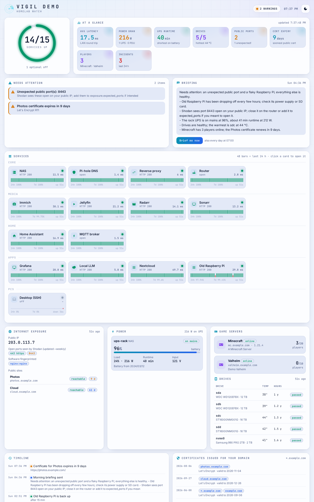

# Vigil — a watchtower for your homelab

One page that answers "is everything OK?" for the whole lab, and tells you when it isn't.



- **Services:** every app and device checked every minute (HTTP or TCP), with latency, 24 h / 7 d uptime, a 48-bar strip of the last day and outage history.
- **Internet exposure:** your public IP, what [Shodan InternetDB](https://internetdb.shodan.io/) has seen open on it (it flags ports you did not mean to open and known vulnerabilities), HTTPS reachability and certificate expiry of your public sites, and every certificate issued for your domain in the [crt.sh](https://crt.sh) transparency logs. A certificate you did not request means someone is playing with your domain.
- **Power:** every UPS and PDU on your [NUT](https://networkupstools.org/) servers: on battery or mains, charge, runtime, watts, battery age.
- **Drives:** health and temperature from [Scrutiny](https://github.com/AnalogJ/scrutiny).
- **Game servers:** Valheim (Steam query) and Minecraft (server list ping): online, players.
- **Briefing:** an LLM writes a short morning summary from the facts, or on demand. Any OpenAI-compatible API works, including your own llama.cpp, Ollama or LM Studio.
- **Alerts** (optional): Discord webhook, [ntfy](https://ntfy.sh) or a Home Assistant webhook. You get alerts for service down/up, UPS on battery, a failing drive, a new public port, a new vulnerability, an expiring certificate, a newly issued certificate, a public IP change, plus the morning briefing.

Vigil needs no passwords or API keys: NUT and Scrutiny are read without logging in, and Shodan InternetDB and crt.sh are free. It's one small Python process with SQLite history, light and dark themes, and a layout that works on a phone.

## Try it in 10 seconds (demo mode)

```sh
docker run --rm -p 8080:8080 -e VIGIL_DEMO=1 ghcr.io/levoniust/vigil:latest
```

Open http://localhost:8080. Demo mode simulates a made-up lab with a flaky Raspberry Pi, an unexpected open port and a certificate about to expire. It makes no network requests, and its data is thrown away when it stops.

## Install

### Docker

```sh
mkdir -p vigil-data && sudo chown 1000:1000 vigil-data
docker run -d --name vigil -p 8080:8080 \
  -v "$PWD/vigil-data:/data" -v /etc/localtime:/etc/localtime:ro \
  --restart unless-stopped ghcr.io/levoniust/vigil:latest
```

Or use [`docker-compose.yml`](docker-compose.yml). Images are built for amd64 and arm64.

On the first start, Vigil writes `vigil-data/config.yaml` from [the example](vigil/config.example.yaml). Edit it: it reloads by itself within a minute, and a broken file keeps the last good settings and shows the error on the page. History is kept in `vigil-data/vigil.db`.

### Python

Python 3.12+:

```sh
git clone https://github.com/levoniust/vigil.git && cd vigil
python3 -m venv .venv && .venv/bin/pip install -r requirements.txt
VIGIL_DATA=./data VIGIL_PORT=8080 .venv/bin/python -m vigil      # add --demo to try it
```

### TrueNAS SCALE

Install it as a Custom App (Apps → Discover → Custom App, or "Install via YAML") with the compose file above. Point the `/data` volume at a dataset folder owned by uid 1000, or set `user:` to the owner of that folder.

### Let your AI agent do it

Point Claude Code, Codex or a similar agent at [docs/AGENT-INSTALL.md](docs/AGENT-INSTALL.md). It's a step-by-step procedure written for agents: discover, ask, install, configure your services, verify.

## Configure

Everything lives in `config.yaml`:

```yaml
checks:
  - {id: nas, name: NAS, group: Core, type: http, url: "https://192.168.1.10/", icon: dns}
  - {id: router, name: Router, group: Core, type: tcp, host: 192.168.1.1, port: 443, icon: router}
  - {id: desktop, name: Desktop, group: PCs, type: tcp, host: 192.168.1.50, port: 22, optional: true}
nut:
  - {name: NAS, host: 192.168.1.10, port: 3493, watts: {ups: 900}}
scrutiny_url: "http://192.168.1.10:8080"
exposure:
  expected_ports: [443]
  domain: example.com
  public_hosts: [{name: Photos, url: "https://photos.example.com/"}]
briefing:
  enabled: true
  url: "http://192.168.1.30:8080/v1/chat/completions"
notify:
  ntfy_url: "https://ntfy.sh/your-secret-topic"
```

- An `http` check is up if the service answers with a status below 500 (or one listed in `expect: [200]`). Self-signed certificates are accepted unless you set `insecure: false`.
- A `tcp` check is up if the port accepts a connection.
- `optional: true` shows a device grey instead of red when it's off, and sends no alert. Use it for PCs that aren't always on.

Privacy: the exposure section sends your public IP to Shodan InternetDB and your domain to crt.sh. Your public IP is looked up with ipify, ifconfig.me or icanhazip. To turn all of that off, set `exposure.enabled: false`.

## Security

The page has no login, so keep it on your LAN or behind your VPN or reverse-proxy authentication. Anyone who can reach it can see your services and trigger refreshes, briefings and test alerts. Webhook URLs and an LLM `api_key` in `config.yaml` are secrets.

## API

`GET /api/state` (everything on the page) · `POST /api/briefing` · `POST /api/refresh/{checks|power|disks|games|exposure|certs|ct}` · `POST /api/test-alert` · `GET /healthz`

## Development

```sh
python3 -m venv .venv && .venv/bin/pip install -r requirements.txt pytest pytest-asyncio
.venv/bin/python -m pytest -q tests
.venv/bin/python -m vigil --demo
```

The backend is aiohttp (`vigil/engine.py` holds the watch loops, `vigil/probes.py` the checks) and the page is a single dependency-free `vigil/static/index.html`.

## License

MIT
